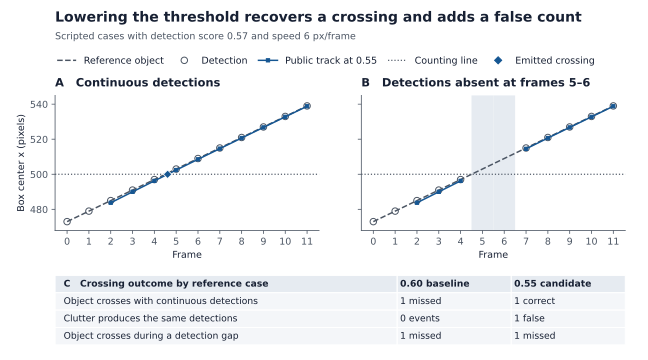

# When recovering more tracks creates false counts

Working manuscript for a controlled study of line-crossing counts with VisionTrack.

## Abstract

An online tracker can recover a valid line crossing by starting a track earlier. The same configuration can also turn persistent false detections into a count. We isolate this trade-off by lowering the track initiation threshold from 0.60 to 0.55 in VisionTrack while holding detections, confirmation and the crossing rule fixed within each pair. Across 54 scripted cases, the candidate recovers at least one true crossing in 10 and violates a prespecified safety endpoint in six. In a matched pair of scenarios, identical detections produce the same public track and crossing, scored as correct when an object exists and false when only clutter exists. A separate case keeps the same track ID across a detection gap and still misses the crossing. The replay and event evidence explain why we retain the baseline configuration. The experiment establishes these mechanisms under scripted conditions. Their prevalence and the candidate's accuracy on traffic cameras remain open.

## Introduction

A line counter consumes track observations and turns them into events. Starting a track before it reaches the line can supply the observations needed for a count. If persistent clutter supplies those same observations, the counter can emit a false event. A surviving ID also may produce a gap in public observations, leaving an adjacent-frame counter without the pair of points it needs. The engineering decision is whether the change that recovers a crossing also adds false counts or other regressions under the specified conditions.

We present a controlled case study and a replayable artifact for tracing this decision. The study changes one tracker setting, scores individual events and retains the negative cases. The released Lab tools provide an adjacent workflow for examining the detection and track lifecycle behind a saved Lab run. The paper replay produces its own study records and figure. The Lab's published crossing explanation shows selected results from the study summary. [Lab crossing explanation](https://visiontrack.hulage.in/lab/crossings#controlled-threshold) · [Lab initiation trace](INITIATION_DIAGNOSTIC.md)

## Related work

**Track initiation and recovery.** ByteTrack uses lower-scoring detections to associate remaining tracks and initializes new tracks from unmatched high-scoring detections. TrackTrack addresses spurious initiation by suppressing candidates that overlap active tracks or stronger detections. Our changed setting is the admission threshold for unmatched proposals already above VisionTrack's fixed 0.50 high-score association threshold. The experiment evaluates the downstream effect of changing that one setting in VisionTrack. [Zhang et al., ByteTrack, ECCV 2022, §3 and Algorithm 1](https://arxiv.org/pdf/2110.06864) · [Shim et al., TrackTrack, CVPR 2025](https://openaccess.thecvf.com/content/CVPR2025/html/Shim_Focusing_on_Tracks_for_Online_Multi-Object_Tracking_CVPR_2025_paper.html)

**Tracking and counting evaluation.** HOTA measures detection, association and localization, and its submetrics help diagnose tracking errors. AI City's vehicle-counting track scores cumulative counts by movement and vehicle class over time. Liu et al. connect missing detections and ID switches to counting errors, and derive movement counts by matching tracklets to typical trajectories. Our endpoint is a single directed crossing rule with one-to-one event matching. We report true, false and missed events separately so an extra count cannot cancel a miss. This endpoint answers a configuration question about the counter, and tracking metrics can provide complementary evidence about its input. [Luiten et al., HOTA, IJCV](https://pmc.ncbi.nlm.nih.gov/articles/PMC7881978/) · [AI City Challenge 2021, Track 1 protocol](https://www.aicitychallenge.org/2021-data-and-evaluation/) · [Liu et al., CVPR Workshops 2020, §§3.2–3.3](https://openaccess.thecvf.com/content_CVPRW_2020/papers/w35/Liu_Robust_Movement-Specific_Vehicle_Counting_at_Crowded_Intersections_CVPRW_2020_paper.pdf)

**Closest artifact comparison.** TrafficLens, an open-source project, compares tracking and counting rules on a fixed detection stream with manually labelled crossings at one gate. It reports individual event errors, tests detection and frame degradation, and isolates an association-threshold change while holding the counting rule and lifecycle fixed. We reviewed its pinned documentation. That overlap rules out a priority claim for fixed-detection replay, event scoring or a one-setting counting ablation. Our specific case study isolates track birth, pairs identical proposals with different references, and links each outcome to public observations and an explicit decision on adoption. The scenarios and scoring rules differ, so the two projects' scores support their respective experiments. [TrafficLens, pinned evaluation and ablations](https://github.com/safdar-hussain1/trafficlens/blob/9aef029c68a9c7dc4c0f112085418483ddbb985c/README.md#measured-results)

## Method

We compare `new_track_thresh` at 0.60 and 0.55 across nine scripted scenarios, three proposal scores (0.54, 0.57 and 0.61) and two speeds (2 and 6 px/frame). Three-hit confirmation and all association settings are fixed. References are scored after replay. The tracker receives only detections. The counter emits an event when two adjacent-frame box centers for the same public ID cross x=500 from left to right within the specified y range. One-to-one scoring matches events within one frame and 10 pixels of crossing height. The 324 passes check fresh and reset repeatability across both variants of the 54 pairs. The cases are authored and provide no estimate of traffic prevalence. [Frozen protocol and safety rule](INITIATION_THRESHOLD_PROTOCOL.md)

## Figure 1



**A.** At a detection score of 0.57 and speed of 6 px/frame, the 0.55 threshold confirms a track at frame 2 and emits a crossing between frames 4 and 5 (diamond). The 0.60 baseline emits no public track in the cases shown. The dashed reference in A applies to the object case. The clutter case supplies identical detections and produces the same tracker output with an empty reference.

**B.** Removing detections at frames 5 and 6 leaves the reference crossing intact. The candidate reports the same ID before and after the gap, with no public observations during the gap. The counter requires consecutive frames and emits no event.

**C.** Scoring the emitted events against the reference produces one correct count for the object and one false count for clutter. Both thresholds miss the gap crossing. All three outcomes also hold at 2 px/frame. [Full 54-case results](https://github.com/hulagerushikesh/visiontrack/blob/main/experiments/initiation_threshold_v1_results.json) · [Results and limitations](INITIATION_THRESHOLD_FINDINGS.md) · [Lab explanation](https://visiontrack.hulage.in/lab/crossings#controlled-threshold)

## Results and interpretation

**Decision and scope.** Keep the baseline threshold. The candidate recovers at least one true crossing in 10 of 54 paired cases and violates at least one prespecified safety endpoint in six. All 36 below-both and above-both score controls yield identical output. These results establish a controlled failure mechanism. Its frequency on traffic cameras and the candidate's field performance remain open. The [box-gate study](BOX_GATE_FINDINGS.md) gives a secondary controlled example where fewer ID switches coexist with worse time-window counts. Broader claims about tracker rankings would need a separate comparison. Keep the [exploratory localization pilot](LTA_LOCALIZATION_PREFLIGHT.md#development-only-spread-pilot--2026-11-13) outside the main argument.

### Reader verification

Rerun the paired study and regenerate Figure 1. Use the directories under the replay output to answer three questions. Each directory contains `inputs.json`, `baseline.json`, `candidate.json` and `scored.json`.

1. In `steady_true-0.57-6`, which frame first contains a public candidate observation, and which two frames supply the crossing?
2. In `persistent_false-0.57-6`, how do the `detector_sha256` and `output_sha256` fields compare with the steady case? Which difference in `inputs.json` changes how the crossing is scored?
3. In `confirmed_gap-0.57-6`, what does `candidate.json` show for the ID and observations immediately before, during and after the gap? Why does the counter emit zero events?

Record whether the reader can make those distinctions using the draft and artifacts, and where they need help. This checks whether the contribution is usable by a reader. A field study would answer how often the mechanisms matter and whether the decision transfers to traffic cameras.

## Reproduce the main experiment

Run from a full Git clone of VisionTrack at the pinned replay revision below. Use Python 3.12.9 and NumPy 2.5.4. The command creates a temporary checkout of the public snapshot, runs the frozen study and compares every per-case result and output hash against the saved summary. It also compares source and configuration fields and records the replay environment. It requires no footage or model files. [Pinned reader instructions](https://github.com/hulagerushikesh/visiontrack/blob/b4ccff0dc415e9755c1dc2448d3b3defc5a87481/docs/INITIATION_THRESHOLD_FINDINGS.md#reproduce-the-study-and-figure)

```bash
git clone https://github.com/hulagerushikesh/visiontrack.git
cd visiontrack
git checkout --detach b4ccff0dc415e9755c1dc2448d3b3defc5a87481
paper_dir=$(mktemp -d)
python3.12 -m venv "$paper_dir/venv"
"$paper_dir/venv/bin/python" -m pip install numpy==2.5.4
"$paper_dir/venv/bin/python" -m experiments.reproduce_initiation_threshold \
  --output "$paper_dir/replay"
```

The original-commit rerun matched the saved summary byte for byte (`fb947930ba3b1a2bf73596a5ffcdb5f76b1d56372edbb4ef47c93e7dbd20fc8d`). The public snapshot has the same source tree and different Git IDs. The replay command checks both public Git IDs, then excludes those two IDs and the environment fields when comparing the summaries. [Public snapshot](https://github.com/hulagerushikesh/visiontrack/commit/4b44af0abb0c7448f6baf796e5cfa1062d52f6a6) · [Saved summary](https://github.com/hulagerushikesh/visiontrack/blob/898593a/experiments/initiation_threshold_v1_results.json)

## Regenerate Figure 1

In the same shell, from the current VisionTrack checkout, run the plotting command after the replay. The plotter checks the selected inputs and both outputs against the frozen case hashes and recomputes the scores before drawing. Pass a `.pdf` output path to export a vector PDF.

```bash
"$paper_dir/venv/bin/python" -m pip install matplotlib==3.10.9
PYTHONPATH=src "$paper_dir/venv/bin/python" -m experiments.plot_initiation_threshold \
  "$paper_dir/replay" "$paper_dir/initiation-threshold.svg"
```

### Verified environments

With Python 3.12.9 and NumPy 2.5.4, macOS arm64, Debian Bookworm arm64 and
Debian Bookworm x86-64 reproduced all 54 pairs, including exact tracker output
hashes. All 216 per-case JSON files were byte-identical. With Matplotlib 3.10.9,
each reproduced the same Figure 1 SVG (`0c19f5f439bfa521a1a57b0cd9b5f81e81b5e5f947fecbb696eb3bf71a416786`, after removing trailing spaces from the SVG).
Both Linux runs used the Docker Python image index
`python@sha256:551c386b532bd5c9a3d84809ebc7d9052771d22c9edb1ccaab0df7307b7bb9e0`
on the same Apple Silicon host, with x86-64 emulated.

The technical replay is complete. Another reader can use the verification
questions to test whether the paper and artifact are easy to follow. Field
validation still requires separately evaluated cameras and independently
checked labels.

## Publication route

Prepare a short computer-vision preprint for arXiv cs.CV, with the LaTeX source
and the replay artifact. This is a candidate route. arXiv assesses scholarly
scope and significance through moderation, and this study's scripted cases
give it a narrow empirical scope. First-time submitters may need endorsement.
An archival project report on Zenodo is an option if we choose to share the
controlled result as a citable artifact. A JOSS software paper would need
evidence of research impact for the Lab or library. [arXiv category taxonomy](https://arxiv.org/category_taxonomy#cs.CV) · [arXiv moderation](https://info.arxiv.org/help/moderation/index.html) · [arXiv endorsement](https://info.arxiv.org/help/endorsement.html) · [Zenodo deposit guide](https://help.zenodo.org/docs/get-started/quickstart/) · [JOSS scope](https://joss.theoj.org/about)

The author has read the draft and confirmed the submission decisions on
2026-11-20: author line "Rushikesh Hulage, Independent researcher"; a
disclosure naming both OpenAI Codex and Anthropic Claude; and the CC BY 4.0
manuscript license. The final LaTeX source and figure are in
[`paper/`](https://github.com/hulagerushikesh/visiontrack/blob/main/paper/README.md). All counts were rechecked against the saved
summary, and every external link resolves. What remains is the author's own
arXiv submission: check endorsement for `cs.CV`, upload the source and
inspect the PDF arXiv builds. [arXiv submission guide](https://info.arxiv.org/help/submit/index.html)
