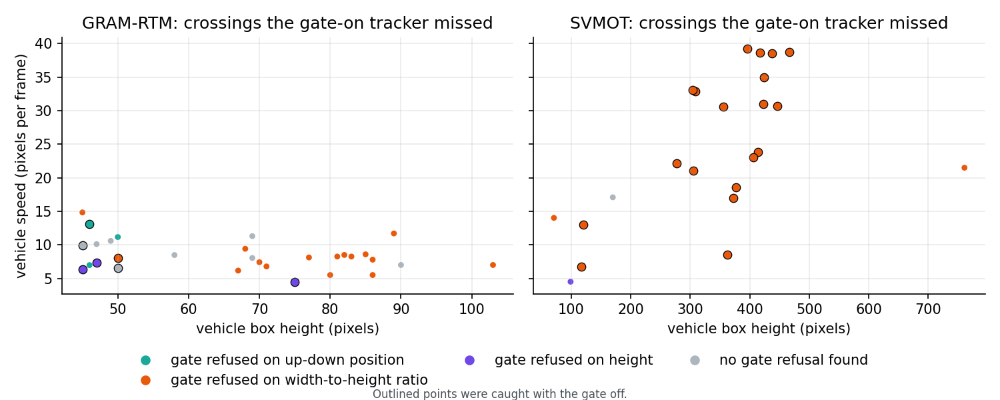

# Why the motion gate misses vehicles on traffic video

Written 2026-11-23 (plan item R1). **This explains results that already
exist. It tests nothing and changes no verdict.** It reuses the GRAM-RTM and
SVMOT detections from the frozen tests, so it is not fresh evidence for or
against changing the default.

## What was done

The saved detections were replayed through the gate-on tracker. Every time
the motion gate refused a pairing that the overlap and class tests would have
allowed, the refusal was recorded and its gate distance was split into four
parts: left-right position, up-down position, width-to-height ratio and
height. The split is exact, because the filter keeps the four parts
independent.

Then, for each reference crossing the gate-on tracker missed, the script
looked for a refusal on that same vehicle in the second before the crossing.
It also recorded the vehicle's speed and box height at the crossing.

**Checks.** The replay reproduced the frozen gate-on output exactly on all 11
sequences, and the same missed crossings: 30 on GRAM-RTM and 23 on SVMOT.

## Findings



**SVMOT: the box's shape, not its speed.** Turning the gate off recovered 19
of the 23 missed crossings. In all 19, the gate had refused that vehicle on
the crossing frame itself, and in all 19 the largest part of the refusal was
the change in width-to-height ratio (a median of 90% of the gate distance).
These vehicles were large (a median of 377 pixels tall) and fast (31 pixels
per frame). Relative to their size, though, they moved only about 0.08 box
heights per frame, which is not unusual. The box changed shape more than the
gate allows. Why it did (perspective close to the camera, the detector's box
fit, or something else) was not measured.

**GRAM-RTM: a different and smaller picture.** Turning the gate off recovered
7 of the 30 missed crossings. Those vehicles were small (a median of 47 pixels
tall) and moved more relative to their size (0.16 box heights per frame).
Three refusals were mainly on height, one on up-down position and one on
width-to-height ratio. Two recovered crossings had no refusal on that vehicle
in the second before, so the gate's effect on them was indirect. Eight of the
30 misses had no gate refusal at all; turning the gate off cannot help those.

**Across all refusals,** not only those near missed crossings, the
width-to-height ratio was the largest part in 85% of the 9,077 refusals on
GRAM-RTM and 73% of the 9,984 on SVMOT. That fits the earlier
[RoundaboutHD diagnosis](ASPECT_GATE_DEVELOPMENT.md), where 86–95% of blocked
pairs failed on the ratio, counted slightly differently. That record also
gives a likely reason: the filter allows a fixed ratio change of 0.1, which is
about a quarter of a pedestrian's ratio but only about a twentieth of a car's.

## Limits

- "Largest part" is not the same as "only cause". A refusal shows the gate
  blocked a pairing; it does not prove that pairing would have been chosen
  with the gate off.
- The one-second look-back and the 0.5 overlap used to tie a refusal to a
  vehicle were chosen for this explanation, not frozen beforehand. They do not
  affect any test verdict.
- The GRAM-RTM sample is small (7 recovered crossings), so its pattern is weak.
- Both venues are fixed cameras over mostly straight roads, with one detector.

## Reproduce

```bash
python -m experiments.gate_miss_explanation \
  --gram-root <gram-rtm-intake folder> --svmot-root <svmot-test folder> \
  --output experiments/gate_miss_explanation_v1_result.json \
  --figure docs/figures/gate-miss-explanation.png
```

The run takes about two minutes and under 200 MB of memory. The datasets
stay owner-local; the result file holds only counts, distances, speeds and
sizes.
